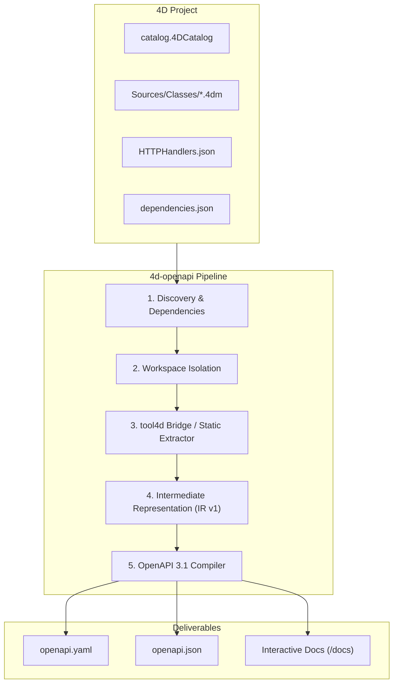

# 4d-openapi Architecture & System Design

## 1. System Overview

`4d-openapi` is a native, cross-platform CLI tool that generates OpenAPI 3.1 specifications from 4D projects. It employs a **hybrid extraction architecture** combining:

1. **Declarative Catalog & Metadata Extraction**: Authoritative parsing of `catalog.4DCatalog`, `environment4d.json`, `dependencies.json`, and `HTTPHandlers.json`.
2. **Dependency Resolution**: Emulation of the 4D Dependency Manager with local precedence, path overrides, digest verification, and offline modes.
3. **Isolated Analysis Workspace**: Projects are analyzed in a sandboxed temporary directory to prevent any modification to user source code.
4. **4D Inspection Engine (`tool4d`)**: Headless execution with `--dataless --skip-onstartup` and small introspection bridge in `4d/extractor/`.
5. **Static Declaration Fallback**: Scoped parser for `.4dm` class definitions to extract function signatures, parameters, return types, and `// @openapi.*` comments.
6. **Intermediate Representation (IR v1)**: A validated, versioned JSON data contract that decouples 4D extraction from OpenAPI code generation.
7. **OpenAPI 3.1 Compiler**: Deterministic compiler producing OpenAPI 3.1 YAML and JSON.
8. **Independent HTTP Server**: Standalone documentation server rendering interactive Scalar UI at `/docs` with `/openapi.yaml`, `/openapi.json`, and `/health` endpoints.

## 2. Confidence Model & Provenance

Every extracted element in the IR carries a `provenance` record with a `confidence` level:

- **`verified`**: Confirmed directly by the 4D runtime (`ds`, `cs`) or authoritative catalog definitions.
- **`inferred`**: Extracted from static source code declarations or regex patterns.
- **`unknown`**: Insufficient information available, triggering diagnostic warnings.

In `--strict` mode, any unverified or inferred metadata prevents emission with exit code `7`.
